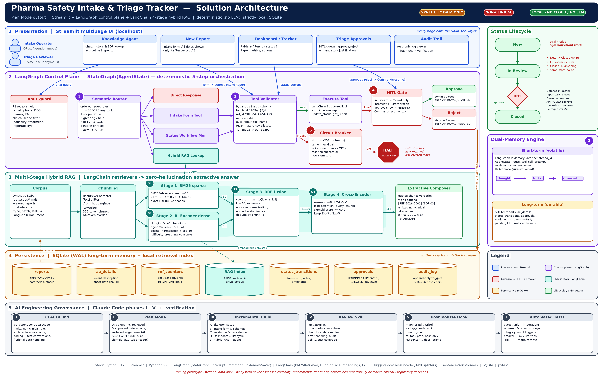

# Pharma Safety Intake & Triage Tracker

A local-only training prototype. Intake operators capture fictional product quality complaints and suspected
adverse event reports. The app validates every field, tracks review through **New -> In Review -> Closed**
with a human-in-the-loop (HITL) close gate, and keeps an append-only, hash-chained audit trail. A
deterministic **LangGraph** agent answers historical and SOP questions using a **4-stage hybrid RAG**
pipeline built from **LangChain** components.

> **Fictional data only.** The system never assesses causality, recommends treatment, determines regulatory
> reportability or makes clinical or regulatory decisions. It makes no cloud calls, no external API calls and
> no LLM calls. Everything runs on `localhost`.



## Quick start (Windows, Python 3.10+)

```bat
python -m venv .venv
.venv\Scripts\activate
pip install torch --index-url https://download.pytorch.org/whl/cpu
pip install -r requirements.txt
pip install -e .
python scripts\download_models.py        :: one-time model fetch (bge-small + ms-marco cross-encoder)
python scripts\seed_demo.py --reset      :: fictional history + demo run -> docs\demo\
streamlit run app.py                     :: http://localhost:8501
pytest -q                                :: 137 tests
```

The models are loaded with `local_files_only=True` and `HF_HUB_OFFLINE=1`. If they aren't cached, the app falls
back to deterministic hash embeddings and a keyword reranker. The pipeline still works, with less semantic matching.

## What's where

| Area | Location |
|---|---|
| AI contract | [CLAUDE.md](CLAUDE.md) |
| Plan Mode output | [docs/plan.md](docs/plan.md), [docs/architecture.png](docs/architecture.png) (rendered by `scripts/render_architecture.py`) |
| Domain (schemas, lifecycle, guards) | `src/pharma_tracker/domain/` |
| SQLite long-term memory + audit | `src/pharma_tracker/persistence/` (`schema.sql` has the append-only triggers) |
| Tool layer (repair -> Pydantic -> StructuredTool, circuit breaker) | `src/pharma_tracker/tools/` |
| LangGraph control plane | `src/pharma_tracker/agent/graph.py`, `router.py`, `service.py` |
| Hybrid RAG | `src/pharma_tracker/rag/` (`sparse`, `dense`, `fusion`, `rerank`, `composer`, `pipeline`) |
| Streamlit UI | `app.py`, `pages/` |
| Review skill | `.claude/skills/pharma-intake-review/` |
| Governance hook | `.claude/settings.json` -> `.claude/hooks/audit_file_edit.py` -> `logs/claude_edit_audit.jsonl` |
| Tests | `tests/unit`, `tests/integration` (`-m models` = real-encoder tests) |
| Demo evidence | `docs/demo/` (walkthrough, RAG result, audit CSV, chain verification) |
| Review evidence | `docs/reviews/` |
| Defense answers | [docs/reflection.md](docs/reflection.md) |

## Spec -> implementation map

| Spec item | Implementation |
|---|---|
| REF-2026-XXXX ids | Per-year counter allocated inside `BEGIN IMMEDIATE` (`repository._next_ref_id`); overflow after 9999 raises an error |
| AE / PQC categories and fields | `IntakeReportIn`. The AE fields are mandatory only for AE reports; onset must be ≤ received and not in the future |
| Mandatory-field validation | Pydantic errors are turned into context-specific messages (`domain/errors.py`) and shown inline on the form |
| Dashboard filters | `pages/2_Dashboard.py` (status / type multiselect, row detail, lifecycle actions) |
| Lifecycle | `domain/lifecycle.py`. Closed is terminal; you can't skip steps or go back |
| Audit trail | `audit_log`: UTC time, pseudonymous actor, action, IDs only; triggers + SHA-256 chain |
| Stage 1 BM25 | `BM25Retriever` with `k1=1.3, b=0.75`. Its tokenizer keeps `LOT-88392` as one token. Top 50 |
| Stage 2 bi-encoder | `HuggingFaceEmbeddings(bge-small-en-v1.5)` + FAISS inner product on normalised vectors (= cosine). 512/64-token chunks counted with the encoder's own tokenizer. Top 50 |
| Stage 3 RRF | `fusion.reciprocal_rank_fusion`, k = 60, uses ranks only |
| Stage 4 cross-encoder | `HuggingFaceCrossEncoder(ms-marco-MiniLM-L-6-v2)`, sigmoid -> keep ≥ 0.40, at most 5. The answer quotes these chunks; with no chunks it declines to answer |
| Step 1 type-safe tools | `tools/registry.py` + `repair.py` (fuzzy tool name, key aliases, lot/ref/status normalisation) |
| Step 2 dual memory | `AgentState` + `InMemorySaver` (short-term ReAct trace), SQLite (long-term) |
| Step 3 router | `agent/router.py` ordered rules R0–R6 (PII, clinical scope, greeting, status, intake, RAG) |
| Step 4 HITL | `hitl_gate` node calls `interrupt()`; Triage page resumes it with `Command(resume=...)`; the repository also refuses to close without approval |
| Step 5 circuit breaker | `tools/circuit_breaker.py`: the 3rd consecutive identical invalid call opens it and halts the graph |
